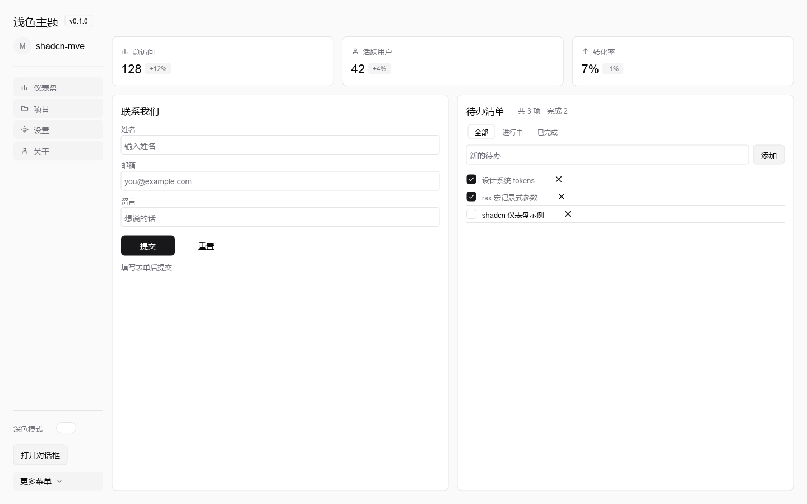
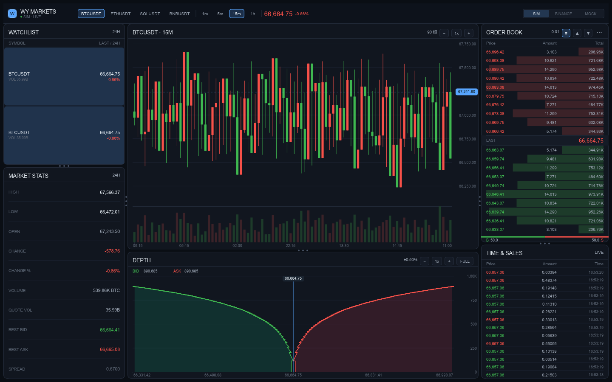

# rust-mve

**纯 Rust 的信号驱动 UI 框架：树只建一次，改数据只重画该重画的那部分。**

[](https://github.com/wy2010344/rust-mve/actions/workflows/ci.yml)
[](https://github.com/wy2010344/rust-mve/actions/workflows/ci.yml)
[](https://github.com/wy2010344/rust-mve/actions/workflows/ci.yml)
[](LICENSE)

<!-- 首屏两张图：左边是框架的通用能力（shadcn 风格看板），右边是复杂业务界面（交易看板） -->
<p align="center">
  
  
</p>

<p align="center"><sub>上面两张图由 <code>cargo run -p wy-app --example finance -- --snapshot out.png</code> 离屏渲染生成 —— 代码跑一次，图就更新一次，不会过期。</sub></p>

---

## 30 秒看懂

```rust
use wy_mve::{rsx, NodeContext};
use wy_signal::{GetValue, SetValue, Signal};

fn counter_ui(cx: &mut NodeContext, count: Signal<i32>) {
    cx.child(rsx! {
        vbox_at(350.0, 250.0) {
            label(format!("Count: {}", count.get()))
            hbox {
                btn { label: "−", on_click: move || count.set(count.get() - 1) }
                btn { label: "+", on_click: move || count.set(count.get() + 1) }
            }
        }
    }.into_node());
}

fn main() -> Result<(), Box<dyn std::error::Error>> {
    let count = Signal::new(0);
    let app = wy_engine::mve_integration::MveApp::new(move |cx| counter_ui(cx, count));
    wy_engine::runner::run(app)
}
```

**关键点不在语法，在最后一句。** `counter_ui` 只在启动时跑一次，
`count.get()` 被记成依赖；点 "+" 改的是信号，
**重新执行的只有那句 `label(...)` 的求值，不是整棵树**。

---

## 这框架解决什么

React 系的模型是「状态变了就重建组件树」。哪怕一个按钮的文案变了，
整棵子树也要重新跑一遍构造逻辑。

这个项目用的是另一条路：

| | React 系 | rust-mve |
|---|---|---|
| 组件树 | 状态变 → 重建 | **只建一次** |
| 更新粒度 | 框架决定（整棵子树） | **数据结构决定**（哪个信号被读） |
| 状态容器 | 一个大对象 | 每项独立信号 |
| 渲染 | DOM diff | GPU 直绘（Vello / wgpu） |

举个具体例子。待办列表如果存成 `Signal<Vec<Item>>`，
勾选一项就要换整个数组、整列表重绘。
这里存成 `todo_ids: Signal<Vec<u32>>` + 每项独立的 `Signal<bool>`——
**勾选一项，只重绘那一个 checkbox**。

这不是框架替你做的决定，是数据结构的结果。

---

## 里面有什么

```
crates/
├── wy-signal/       信号系统：Signal / Memo / TrackSignal / 批量更新
├── wy-layout/       布局引擎：Flex / Stack / Absolute（一维，自研）
├── wy-mve/          MVE 框架：Node 树、rsx! 组件、滚动容器、浮层
├── wy-mve-macros/   proc-macro：rsx! 声明式语法、#[component]
├── wy-render/       渲染管线：Scene 中间层、Vello 集成、离屏出图
├── wy-text/         文本排版：Parley shaping、字体缓存
├── wy-engine/       引擎整合：事件、焦点、无障碍（AccessKit）
└── wy-app/          示例应用
```

**技术选型**：渲染 Vello + wgpu（GPU compute shader 2D，纯 Rust）·
布局自研 · 文本 Parley · 窗口 winit · 无障碍 AccessKit · 信号自研。

自研的部分（信号、布局、MVE）是为了**精确控制更新粒度**；
其余尽量用生态成熟件，不重复造。

---

## 跑起来

### 不想装 Rust？

从 [Releases](https://github.com/wy2010344/rust-mve/releases) 下载 `rust-mve-demo-windows-x64.zip`，
解压后双击任意 `.exe` 即可 —— **无需安装 Rust 或任何运行库**。

### 从源码跑

```bash
git clone https://github.com/wy2010344/rust-mve.git
cd rust-mve

# 交易看板 —— 默认走内置合成行情，不联网也能跑
cargo run -p wy-app --example finance

# 看板 / 表单 / 待办（shadcn 风格）
cargo run -p wy-app --example shadcn

# 最小示例
cargo run -p wy-app --example counter
```

需要 Rust 1.98+（仓库已用 `rust-toolchain.toml` 锁定版本）和一块能跑 wgpu 的显卡。
交易看板顶栏可以在 `SIM` / `BINANCE` / `MOCK` 之间切换数据源。

> **想不出图？** 每个示例都支持 `--snapshot`，不开窗口直接渲染成 PNG：
> ```bash
> cargo run -p wy-app --example finance -- --snapshot shot.png
> ```
> README 上面那两张图就是这么生成的 —— **图跟着代码走，不会过期**。

---

## 它现在能做到什么

不是玩具计数器。这些是**实际跑起来**的：

- **复杂业务界面** —— 交易看板：K 线、累计深度图（面积+折线）、订单簿、逐笔成交，
  全部信号驱动，数据后台线程推送
- **表单与列表** —— 文本框（真实焦点与键盘输入）、checkbox、待办清单（增删改+筛选）
- **浮层** —— Dialog（遮罩+焦点圈定+Esc 关闭）、Dropdown（空间不足自动向上翻转）
- **滚动容器** —— 溢出才响应滚轮、浮动滚动条、嵌套放行
- **矢量图标** —— 路径绘制，不依赖字体字形（不会在缺字形的机器上变豆腐块）
- **无障碍** —— AccessKit 树，屏幕阅读器可读
- **离屏渲染** —— 无窗口出 PNG，文档配图与 CI 截图都用它

---

## 文档

| | |
|---|---|
| [DESIGN.md](DESIGN.md) | **取舍记录**——为什么这样而不那样（面试官更想看这个） |
| [docs/node-layer-gaps.md](docs/node-layer-gaps.md) | Node 层与 Kotlin 上游的复刻偏差及补齐方案 |
| [docs/02-组件写法范式.md](docs/02-组件写法范式.md) | 组件写法与常见坑 |
| [docs/01-ooc与rust-mve写法对照.md](docs/01-ooc与rust-mve写法对照.md) | 两种声明式写法的对照 |
| [docs/00-Rust-UI框架调研报告.md](docs/00-Rust-UI框架调研报告.md) | 生态调研 |
| [AGENTS.md](AGENTS.md) | 项目约束与协作规范 |

---

## 关于这个项目

它是 Kotlin 版 `wy-helper-kotlin`（Skia + 自研 MVE）的 Rust 复刻——
同一套信号模型和布局思路，换一套技术栈重写一遍。

**代码全部公开，包括踩过的坑。** `DESIGN.md` 里写了具体的技术坑
（比如 `syn` 把 `if` 分支误判成 struct 字面量、`Color::from_u32` 的字节序写反
导致深度图买盘变蓝），这些比架构图更能说明是人写的。

## License

[MIT](LICENSE)
