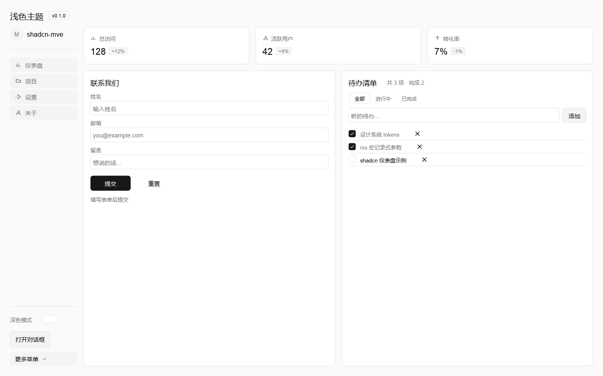
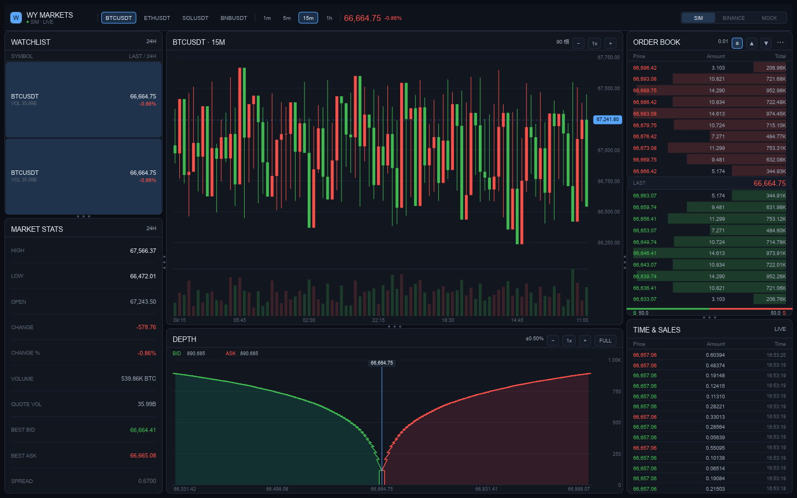

# rust-mve

**纯 Rust 的信号驱动 UI 框架：树只建一次，改数据只重画该重画的那部分。**

[](https://github.com/wy2010344/rust-mve/actions/workflows/ci.yml)
[](https://github.com/wy2010344/rust-mve/actions/workflows/ci.yml)
[](https://github.com/wy2010344/rust-mve/actions/workflows/ci.yml)
[](LICENSE)

<!-- 首屏两张图：左边是框架的通用能力（shadcn 风格看板），右边是复杂业务界面（交易看板） -->
<p align="center">
  
  
</p>

<p align="center"><sub>上面两张图由 <code>cargo run -p wy-app --example finance -- --snapshot out.png</code> 离屏渲染生成 —— 代码跑一次，图就更新一次，不会过期。</sub></p>

---

## 30 秒看懂

```rust
use wy_mve::{flex, node2, rec, wrapped_text_node, AlignItem, Fc, Layout, Node2, Scene};
use wy_signal::{GetValue, SetValue, Signal};

/// 一个按钮：圆角底板 + 居中文字，尺寸由文字撑开，点击改信号。
#[rec]
fn btn(text: String, on_click: impl Fn() + 'static) -> Fc {
    node2! {
        padding: 8.0,
        layout: flex! { direction: Layout::Row, align_item: AlignItem::Center },
        mouse_click: move |_e| on_click(),
        draw: |s: &mut Scene, n: &Node2| {
            s.fill_round_rect(Rect::new(0.0, 0.0, n.width(), n.height()), 8.0, ACCENT);
        },
        children: vec![wrapped_text_node! { text: text, font_size: 14.0, color: BG }],
    }
}

/// 页面：节点只建一次，`count.get()` 在绘制期被记成依赖。
fn counter(count: Signal<i32>) -> Fc {
    node2! {
        layout: flex! { direction: Layout::Column, align_item: AlignItem::Center, gap: 12.0 },
        children: vec![
            wrapped_text_node! { text: format!("Count: {}", count.get()), font_size: 28.0 },
            node2! {
                layout: flex! { direction: Layout::Row, gap: 8.0 },
                children: vec![
                    btn("−".to_string(), move || count.set(count.get() - 1)),
                    btn("+".to_string(), move || count.set(count.get() + 1)),
                ],
            },
        ],
    }
}

fn main() -> Result<(), Box<dyn std::error::Error>> {
    let count = Signal::new(0i32);
    let app = Node2App::new(move |viewport| {
        build_root_node2(root_arg(viewport), move |cx| cx.child(counter(count)))
    })
    .with_size(420.0, 260.0)
    .with_title("counter");
    run(app)
}
```

**关键点不在语法，在最后一句。** `counter` 只在启动时跑一次，
`count.get()` 被记成依赖；点 "+" 改的是信号，
**重新执行的只有那句 `wrapped_text_node!` 的 `text` 求值，不是整棵树**。

（完整可跑版见 [`examples/node2/counter.rs`](crates/wy-app/examples/node2/counter.rs)，
含 `root_arg`、主题常量与 `#[rec]` 组件的完整定义。）

---

## 这框架解决什么

React 系的模型是「状态变了就重建组件树」。哪怕一个按钮的文案变了，
整棵子树也要重新跑一遍构造逻辑。

这个项目用的是另一条路：

| | React 系 | rust-mve |
|---|---|---|
| 组件树 | 状态变 → 重建 | **只建一次** |
| 更新粒度 | 框架决定（整棵子树） | **数据结构决定**（哪个信号被读） |
| 状态容器 | 一个大对象 | 每项独立信号 |
| 渲染 | DOM diff | GPU 直绘（Vello / wgpu） |

举个具体例子。待办列表如果存成 `Signal<Vec<Item>>`，
勾选一项就要换整个数组、整列表重绘。
这里存成 `todo_ids: Signal<Vec<u32>>` + 每项独立的 `Signal<bool>`——
**勾选一项，只重绘那一个 checkbox**。

这不是框架替你做的决定，是数据结构的结果。

---

## 里面有什么

```
crates/
├── wy-signal/       信号系统：Signal / Memo / TrackSignal / 批量更新
├── wy-layout/       布局引擎：Flex / Stack / Absolute（一维，自研）
├── wy-mve/          MVE 框架：Node2 树、声明式组件、滚动容器、浮层
├── wy-mve-macros/   proc-macro：`#[rec]` 命名参数组件宏
├── wy-render/       渲染管线：Scene 中间层、Vello 集成、离屏出图
├── wy-text/         文本排版：Parley shaping、字体缓存
├── wy-engine/       引擎整合：事件、焦点、无障碍（AccessKit）
└── wy-app/          示例应用
```

**技术选型**：渲染 Vello + wgpu（GPU compute shader 2D，纯 Rust）·
布局自研 · 文本 Parley · 窗口 winit · 无障碍 AccessKit · 信号自研。

自研的部分（信号、布局、MVE）是为了**精确控制更新粒度**；
其余尽量用生态成熟件，不重复造。

---

## 跑起来

### 不想装 Rust？

从 [Releases](https://github.com/wy2010344/rust-mve/releases) 下载 `rust-mve-demo-windows-x64.zip`，
解压后双击任意 `.exe` 即可 —— **无需安装 Rust 或任何运行库**。

### 从源码跑

```bash
git clone https://github.com/wy2010344/rust-mve.git
cd rust-mve

# 交易看板 —— 默认走内置合成行情，不联网也能跑
cargo run -p wy-app --example finance

# 看板 / 表单 / 待办（shadcn 风格）
cargo run -p wy-app --example shadcn

# 待办清单（对标 mve-vite-demo 的 canvas-render2：跨项选择、嵌套滚动、输入面板）
cargo run -p wy-app --example canvas2-todo

# 基础元素展示（矩形 / 图片 / 富文本 / 跨组件选择）
cargo run -p wy-app --example canvas2-demo

# 最小示例（纯 Node2 运行时）
cargo run -p wy-app --example node2-counter
```

需要 Rust 1.98+（仓库已用 `rust-toolchain.toml` 锁定版本）和一块能跑 wgpu 的显卡。
交易看板顶栏可以在 `SIM` / `BINANCE` / `MOCK` 之间切换数据源。

> **想不出图？** 每个示例都支持 `--snapshot`，不开窗口直接渲染成 PNG：
> ```bash
> cargo run -p wy-app --example finance -- --snapshot shot.png
> ```
> README 上面那两张图就是这么生成的 —— **图跟着代码走，不会过期**。

---

## 它现在能做到什么

不是玩具计数器。这些是**实际跑起来**的：

- **复杂业务界面** —— 交易看板：K 线、累计深度图（面积+折线）、订单簿、逐笔成交，
  全部信号驱动，数据后台线程推送
- **表单与列表** —— 文本框（真实焦点与键盘输入）、checkbox、待办清单（增删改+筛选）
- **浮层** —— Dialog（遮罩+焦点圈定+Esc 关闭）、Dropdown（空间不足自动向上翻转）
- **滚动容器** —— 溢出才响应滚轮、浮动滚动条、嵌套放行
- **矢量图标** —— 路径绘制，不依赖字体字形（不会在缺字形的机器上变豆腐块）
- **无障碍** —— AccessKit 树，屏幕阅读器可读
- **离屏渲染** —— 无窗口出 PNG，文档配图与 CI 截图都用它

---

## 文档

| | |
|---|---|
| [DESIGN.md](DESIGN.md) | **取舍记录**——为什么这样而不那样（面试官更想看这个） |
| [docs/08-实现原则.md](docs/08-实现原则.md) | **实现红线**——10 条原则、AI 失效模式自查表、动手前五问 |
| [docs/07-旧体系迁移实测.md](docs/07-旧体系迁移实测.md) | 从 v1 迁到 canvasRender2 的实测记录与硬规律 |
| [docs/05-canvasRender2对标审计.md](docs/05-canvasRender2对标审计.md) | 与 TS canvasRender2 的逐项对标 |
| [docs/01-ooc与rust-mve写法对照.md](docs/01-ooc与rust-mve写法对照.md) | 两种声明式写法的对照 |
| [docs/00-Rust-UI框架调研报告.md](docs/00-Rust-UI框架调研报告.md) | 生态调研 |
| [AGENTS.md](AGENTS.md) | 项目约束与协作规范 |

---

## 关于这个项目

它是 Kotlin 版 `wy-helper-kotlin`（Skia + 自研 MVE）的 Rust 复刻——
同一套信号模型和布局思路，换一套技术栈重写一遍。

**代码全部公开，包括踩过的坑。** `DESIGN.md` 里写了具体的技术坑
（比如 `syn` 把 `if` 分支误判成 struct 字面量、`Color::from_u32` 的字节序写反
导致深度图买盘变蓝），这些比架构图更能说明是人写的。

## License

[MIT](LICENSE)
